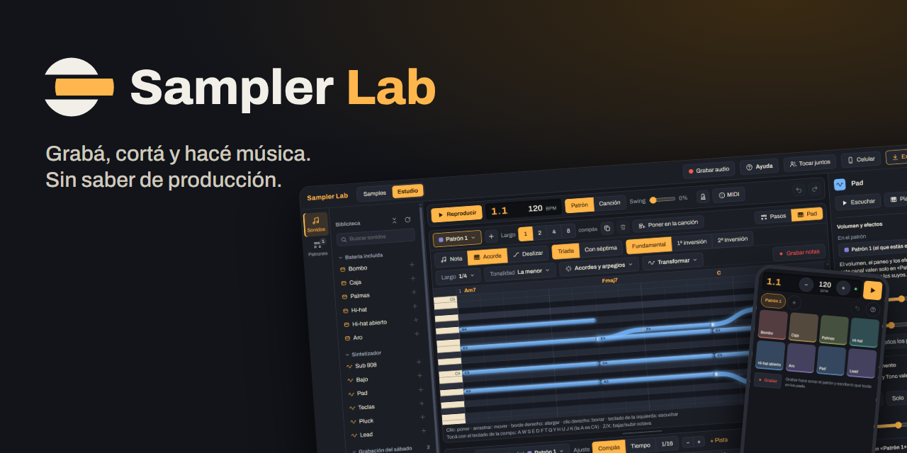
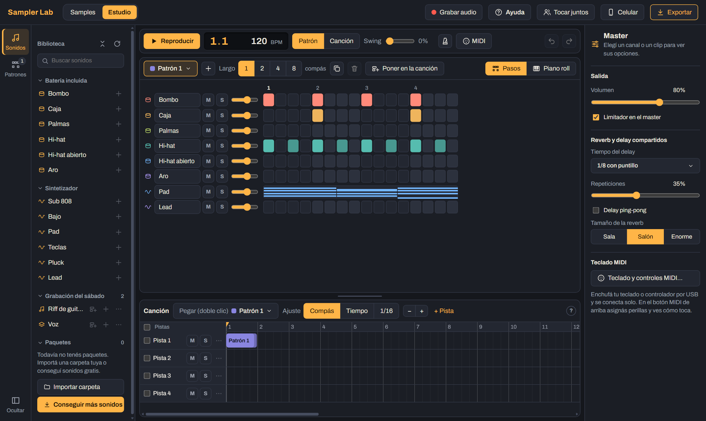
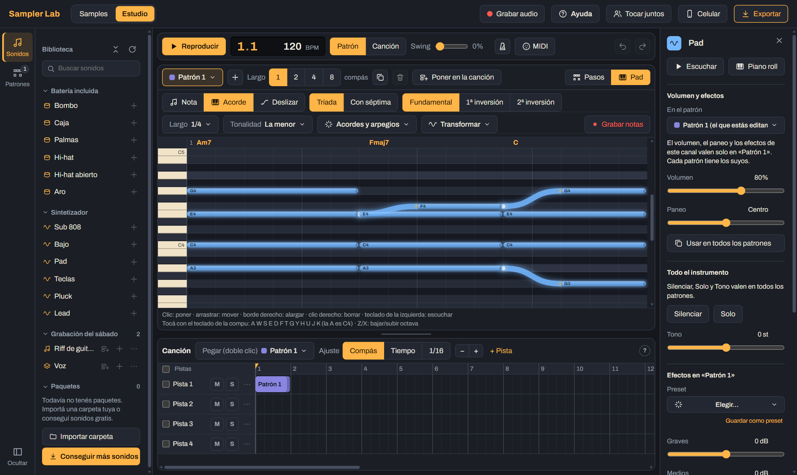
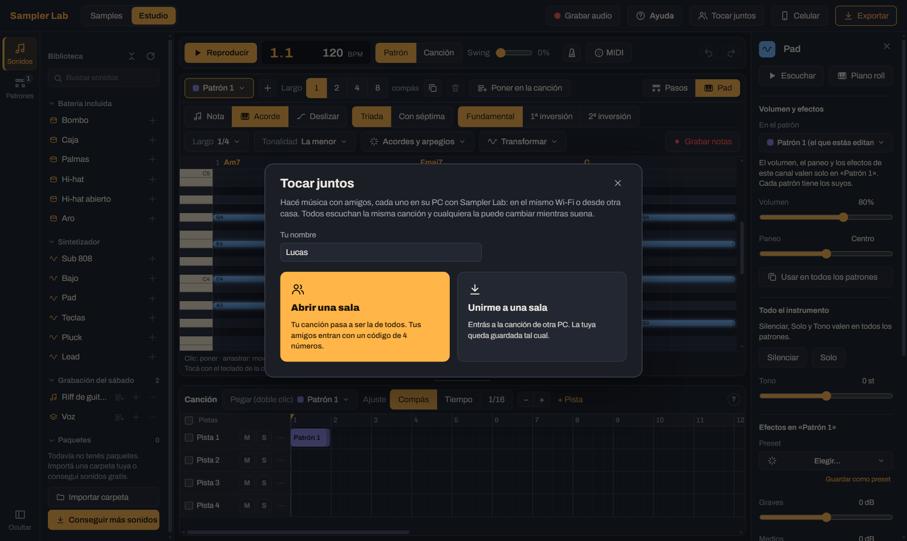
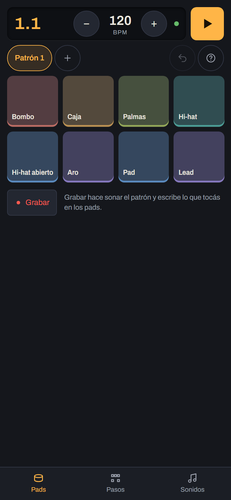
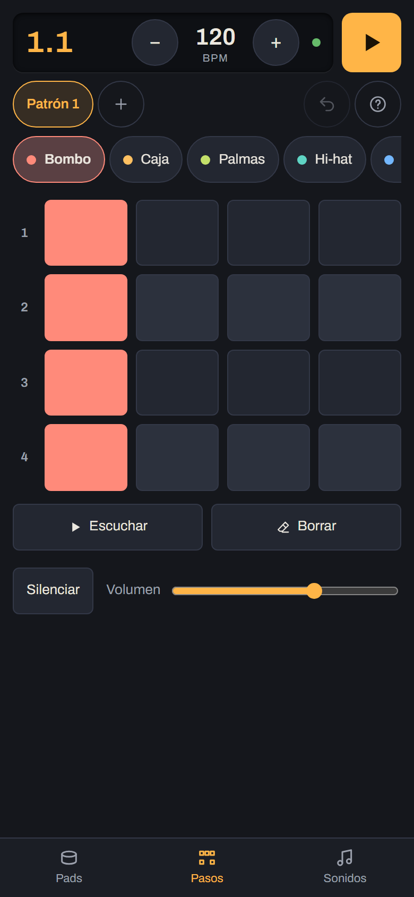

<p align="center">
  
</p>

<p align="center">
  <b>Grabá, cortá y hacé música. Sin saber de producción.</b><br>
  Una app gratis y libre para Windows, en castellano.
</p>

<p align="center">
  <a href="https://github.com/lucascardone/sampler-lab/releases/latest"></a>
  <a href="https://ko-fi.com/lucascardone"></a>
  <a href="LICENSE"></a>
</p>

---

Sampler Lab es para la persona que escucha algo y piensa *"con ese pedacito armaría un
tema"*, pero nunca abrió un programa de música porque parecen tableros de avión.

1. **Conseguí el audio:** arrastrá un archivo o grabá lo que está sonando en tu compu.
2. **Cortá samples:** marcá la parte que te gusta, sumale efectos, separá la voz de la batería.
3. **Armá el tema:** una grilla de pasos, un piano roll que te sugiere acordes y una línea de tiempo.
4. **Sumá gente:** tocá desde el celu o con amigos, cada uno en su PC, aunque estén en otra casa.

## Lo que podés hacer

### Hacer un beat en un minuto

Batería y sintetizador incluidos. Clic en los cuadraditos y ya suena. Cada sonido tiene su
volumen, paneo y efectos (graves, eco, reverb, compresor) con presets para no pelearte con
perillas.



### Acordes sin saber teoría

Elegís la tonalidad y el piano roll resalta las notas que combinan. Con un clic ponés un
acorde entero, o pedís una progresión ("Am F C G") y se llena sola. Arpegios, deslizamientos
y transformaciones con un botón.



### Tus samples, de cualquier lado

- **Grabá lo que suena en la PC** con un clic en el ícono de la bandeja. Clic otra vez y se guarda.
- **Separá instrumentos** con IA (voz, batería, bajo, guitarra, piano), todo en tu compu, sin
  subir nada a internet.
- **Detecta tempo, tonalidad y nota**, y ajusta el sample al tempo de tu tema sin cambiarle el tono.
- **Efectos no destructivos:** el original nunca se toca, así que todo se puede deshacer.
- **~100 instrumentos y miles de sonidos libres** para bajar desde la app, todos con licencia
  y autor.

### Tocar juntos

Abrí una sala y tus amigos entran con un código de 4 números. Todos escuchan la misma canción
y cualquiera la cambia mientras suena. Funciona en el mismo Wi-Fi y también desde otra casa
con una invitación por chat: sin cuentas y sin instalar nada más.



### El celu como controlador

Escaneás un QR y el celu se vuelve pads y grilla de pasos, conectado a la misma canción de la PC.

<p>
  
  &nbsp;
  
</p>

### Y además

Teclado o controlador MIDI (se conecta solo, con perillas asignables) · exportar a WAV, por
pistas (stems) o MIDI · deshacer en todo · se guarda solo · manual completo adentro de la app.

## Descargar e instalar

1. Bajá `Sampler Lab_x.y.z_x64-setup.exe` de la
   [última versión](https://github.com/lucascardone/sampler-lab/releases/latest) (o desde
   [itch.io](https://lucascardone.itch.io/sampler-lab)).
2. Abrilo. No pide permisos de administrador.
3. Windows puede mostrar **"Windows protegió tu PC"** porque la app todavía no tiene firma
   digital (cuesta plata cada año). Tocá **Más información → Ejecutar de todas formas**.

**Requisitos:** Windows 10 u 11 de 64 bits. Para separar instrumentos, la primera vez la app
baja el separador: ~250 MB para procesador o ~3 GB si tenés una placa NVIDIA (mucho más
rápido). El resto funciona sin internet.

¿Dudas? Botón **Ayuda** dentro de la app, o abrí un
[issue](https://github.com/lucascardone/sampler-lab/issues).

## Apoyar el proyecto

Sampler Lab es gratis y lo va a seguir siendo. Si te sirvió:

- ☕ **Invitame un cafecito en [Ko-fi](https://ko-fi.com/lucascardone)**
- 💸 En [itch.io](https://lucascardone.itch.io/sampler-lab) podés pagar lo que quieras al bajarla
- ⭐ Dale una estrella al repo y mostrale a alguien lo que hiciste con la app

## Usarla con responsabilidad

- Sos responsable de tener los derechos del material que sampleás si vas a publicar o vender
  lo que hagas. Para tus temas, lo más tranquilo es samplear tus propias grabaciones o sonidos
  con licencia libre (la app trae un buscador de esos).
- La app **no baja** audio de YouTube, Spotify ni SoundCloud.
- La separación usa [Demucs](https://github.com/adefossez/demucs). Su código es MIT, pero la
  licencia de los modelos entrenados no está clara (el de guitarra y piano probablemente sea
  solo para uso no comercial). La app no los incluye: se bajan de su fuente original la
  primera vez. Detalle en [docs/MODELS.md](docs/MODELS.md).

## Para desarrolladores

Tauri 2 + React + TypeScript, núcleo de audio en Rust y separador en Python (Demucs).

Requisitos: [Node.js](https://nodejs.org) 20+, [Rust](https://rustup.rs) stable y
[uv](https://docs.astral.sh/uv/). En Windows 10/11 ya viene WebView2.

```sh
cd app
npm install
npm run tauri dev                 # la app en modo desarrollo
npx tauri build --bundles nsis    # el instalador de Windows
```

Tests: `npm test` y `npx tsc --noEmit` en `app/`, `cargo test` en `app/src-tauri/` y
`uv run pytest` en `engine/`. El separador se prepara desde la app la primera vez que lo
usás. Formatos de archivo: [canción](docs/SONG_SCHEMA.md) y
[paquetes de sonidos](docs/PACK_SCHEMA.md).

Los issues y pull requests son bienvenidos. Por ahora la app está solo en castellano y solo
se probó en Windows.

## Licencia

Copyright © 2026 Lucas Cardone.

Sampler Lab es software libre: podés usarlo, estudiarlo, modificarlo y compartirlo bajo la
[GNU General Public License v3.0 o posterior](LICENSE). Si distribuís una versión
modificada, tiene que ser con la misma licencia y con su código.

Hecho con [Tauri](https://tauri.app), [Demucs](https://github.com/adefossez/demucs),
[iroh](https://iroh.computer), [Symphonia](https://github.com/pdeljanov/Symphonia),
[wavesurfer.js](https://wavesurfer.xyz), la tipografía
[Archivo](https://fonts.google.com/specimen/Archivo) e instrumentos libres de
[sfzinstruments](https://github.com/sfzinstruments), [FreePats](https://freepats.zenvoid.org)
y [Openverse](https://openverse.org). Gracias a todos los que los hacen.
