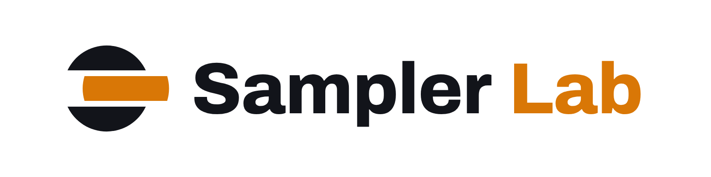

# Marca de Sampler Lab



**La idea:** una canción cortada en tajadas, con la del medio corrida. Sacás un pedazo y es
tuyo, que es lo que hace la app.

## Archivos

| Archivo | Para qué |
|---|---|
| `logo-horizontal-oscuro.svg` / `-claro.svg` | Uso principal: README, itch.io, redes, encabezados. |
| `logo-apilado-oscuro.svg` / `-claro.svg` | Espacios cuadrados o angostos. |
| `logo-horizontal-negro.svg` | Impresión en un color, sellos, grabados. |
| `simbolo-color-oscuro.svg` / `-claro.svg` | El símbolo solo, cuando el nombre ya está escrito cerca. |
| `simbolo-negro.svg` / `simbolo-blanco.svg` | Un color, sobre fondos claros u oscuros. |
| `simbolo-chico.svg` | **Versión para tamaños chicos** (menos de 48 px): separaciones más anchas para que no se cierren. |
| `icono-app.svg` | Ícono de la app (cuadrado oscuro con el símbolo chico). Fuente de todos los íconos. |
| `*.png` | Versiones listas para subir: ícono 1024 px (avatar de Ko-fi/itch), logos 1600 px. |

"Oscuro" = para fondos oscuros, "claro" = para fondos claros.

**Regenerar los íconos de la app** (desde `app/`):
```sh
npx tauri icon ../docs/marca/icono-app.svg
```
y copiar el mismo SVG a `app/public/icono.svg` (favicon del modo celular).

## Colores

| Nombre | HEX | RGB | Uso |
|---|---|---|---|
| Ámbar | `#FFB74D` | 255 183 77 | La tajada y "Lab" sobre fondo oscuro. Es el `--accent` de la app. |
| Ámbar profundo | `#D97706` | 217 119 6 | La tajada y "Lab" sobre fondo claro (el ámbar claro no contrasta con blanco). |
| Noche | `#12141A` | 18 20 26 | Fondo de la app y del ícono; tinta sobre fondo claro. |
| Papel | `#F2EFE9` | 242 239 233 | Tinta sobre fondo oscuro. |

## Tipografía

**Archivo ExtraBold (800)**, la misma de la app. Licencia SIL Open Font License: se puede usar
en logos. En los SVG las letras ya están convertidas en trazos, así que no hace falta tener la
fuente instalada.

## Reglas

- **Aire alrededor:** dejá libre al menos el alto de una tajada (un tercio del símbolo) en todos
  los lados.
- **Tamaño mínimo:** símbolo 16 px (con `simbolo-chico.svg`); logo horizontal 120 px de ancho.
- **Fondos:** oscuro o claro lisos. Sobre fotos, usá la versión blanca o negra.
- **No:** cambiar los colores de la tajada por otros, girar el símbolo, separar las tajadas de
  otra forma, agregar sombras o degradés, ni deformarlo.

## Notas

- Diseñado el 21/11/2026 con la skill `logo-design` (pruebas a 16 px, un color, invertido y
  comparación con logos del rubro).
- No se hizo una búsqueda de marcas registradas. Antes de registrar el nombre o el logo como
  marca, conviene buscarlo en el INPI y hacer una búsqueda inversa de imágenes.
